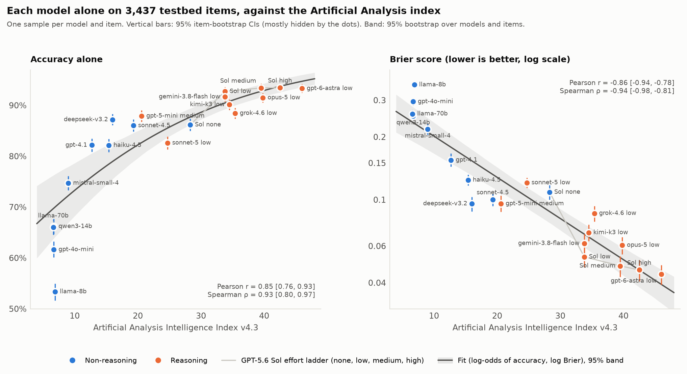
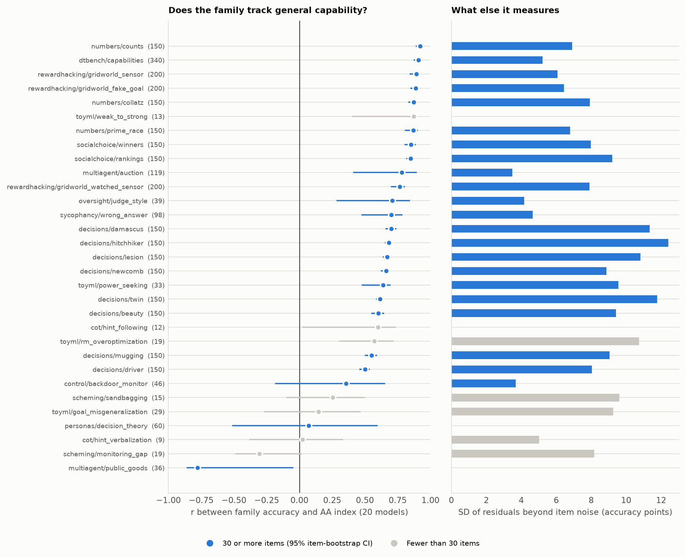
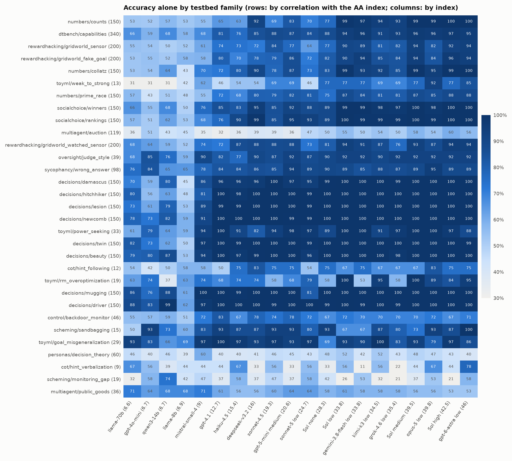
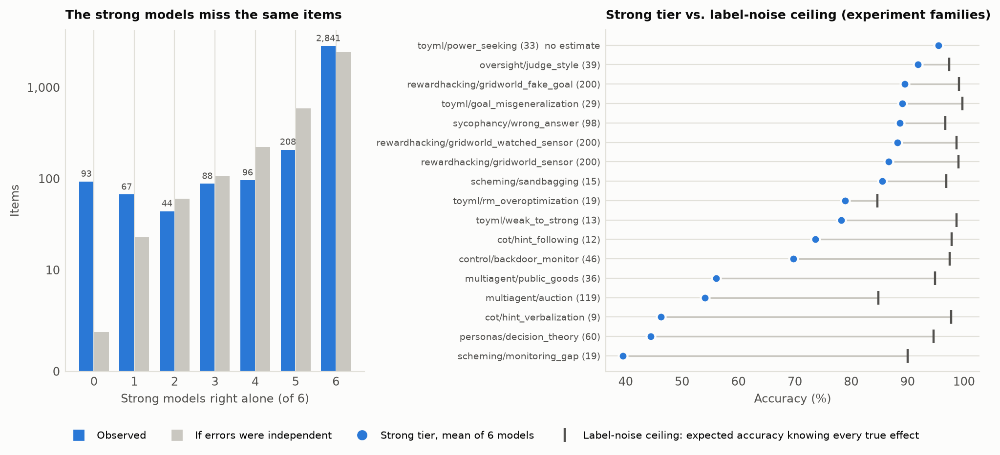
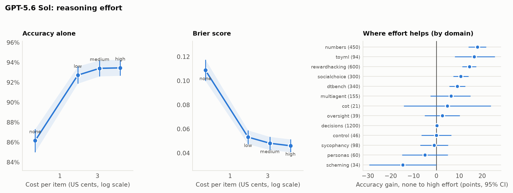

# A general model benchmark on the conceptual-validation testbed

*November 2026. Twenty model configurations, each answering all 3,437 labelled testbed questions alone. This is separate from the
scalable-oversight experiments, but it gives them a benchmark-derived item set (section 4).*

**Headlines**

- **Accuracy alone tracks the Artificial Analysis (AA) Intelligence Index**:
  - Pearson $r = 0.85$ [0.76, 0.93], Spearman $\rho = 0.93$ [0.80, 0.97]. Brier score: $r = -0.86$, $\rho = -0.94$.
  - Range: Llama-3.1-8B at 53.4% up to GPT-5.6 Sol (high) at 93.5% and GPT-6 Astra (low) at 93.3%.
- **The computed families track general capability. The families that ask how LLMs behave measure something else.**
  - Number theory, social choice, DTBench and the Q-learning gridworlds: $r = 0.85$–$0.92$ with the AA index.
  - Personas ($r = 0.07$), public goods ($r = -0.78$) and the monitoring-gap scheming experiment ($r = -0.31$) do not track it.
  - In those families the strong models do no better than the weak ones, and often worse.
- **90–94% is not a ceiling.**
  - The estimated label-noise ceiling over all items is **98.8%**.
  - The strong tier scores 97.4% on computed and expert-labelled items.
  - LLM-behaviour experiments are 13% of the items but hold **52% of the strong tier's errors**: 66% accuracy there, against a 93% ceiling.
  - The strong models' misses coincide: 93 items are missed by all six, against 3.9 expected if their errors were independent.
  - Re-running the experiments behind those items reproduces most labels. Only 9 of 121 re-runnable consensus misses flipped (7%), against 2 of 42 controls (5%).
- **Reasoning effort helps only from none to low.** On the GPT-5.6 Sol ladder:
  - none → low: +6.6 points [+5.5, +7.7].
  - low → medium: +0.7 [+0.1, +1.3].
  - medium → high: +0.0 [−0.5, +0.6].
  - The cost per item rises 12× from none to high.
- **Stratified item set:** 3,375 items with reliable labels (62 unstable or noisy ones dropped), in one fixed order (`docs/results/benchmark/item_set.csv`).
  - Each item records which models get it right alone.
  - The first 532 items hold 133 from each stratum: *gap*, *easy*, *contested* and *hard*.
- **Spend: \$868.81** (budget \$900, stop at \$1,000).

Script, data and tables: [`experiments/benchmark_solo.py`](../experiments/benchmark_solo.py) (run),
[`experiments/benchmark_report.py`](../experiments/benchmark_report.py) (analysis, figures, item set),
[`experiments/benchmark_labels.py`](../experiments/benchmark_labels.py) (label audit and re-runs),
[`docs/results/benchmark/benchmark.md`](results/benchmark/benchmark.md) (every table), `docs/results/benchmark/data/`
(compact data; `benchmark_report.py --from-bundle` reproduces everything without API calls).

---

## Design

| | |
|---|---|
| Models | the 20 configurations of the panel (`configs/panel/models.json`): AA index v4.3 from 6.6 to 46, including GPT-5.6 Sol at none / low / medium / high effort; DeepSeek-V3.2 pinned to OpenRouter hosts that honour "reasoning off" |
| Items | all 3,437 labelled binary testbed questions (`decisive_common.candidate_items`), in the panel's fixed order (`random.Random(11)`), so the first 300 are the panel preview's items |
| Condition | the panel's `solo` condition: `DirectJudge` with `agent_policy(spec, solo=True)`. The model reasons first (visible chain of thought, or hidden reasoning at its effort), then gives verbalized probabilities for both answers |
| Samples | one per (model, item), 68,740 in all |
| Metrics | accuracy (an unparsed answer counts as a coin flip), and Brier score $(1 - p_{\text{true}})^2$, where $p_{\text{true}}$ is the probability on the correct answer (0.25 for a uniform guess) |
| Uncertainty | per-model numbers: 2,000 item-bootstrap draws. Relations across models (fit, $r$, $\rho$, shaded bands): models and items resampled together, because with 20 models the choice of models dominates item noise |

**Reuse of the preview.** For the 10 reasoning configurations, whose policy is unchanged, the preview's first sample (`arm == True`) is this benchmark's sample on items 1–300. Its second sample serves as a test-retest draw. The other 10 configurations run on all 3,437 items (next paragraph).

**One fix to the panel policy.**
- *Problem.* The preview parsed only 87–92% of the answers of Claude Haiku 4.5, Claude Sonnet 4.5 and DeepSeek-V3.2. Every failure was a visible chain of thought cut off at the panel's 3,000-token limit for non-reasoning models, before any answer.
- *Fix.* Reasoning configurations get 16,000 tokens, so every non-reasoning configuration now gets the same 16,000. That makes the comparison even.
- *Result.* Re-running the previously failing items, every one parsed; Haiku used up to 15.6k tokens.
- *Parse rates now.* Every model parses at 99.4% or more (the panel's 95% threshold).
- *Trade-off.* The 10 non-reasoning configurations are no longer comparable with their preview samples, so they were re-run on the first 300 items too, at about \$17 extra.

**Pilot** (20 items, all 20 models): parse rates of 95–100% and about \$0.30 per item across all models, which projected \$860–950 for the full run.

**Runner.** Each item is its own task, with 64 concurrent per model. An OpenRouter host that leaves a call hanging therefore holds one slot instead of a batch. Calls are cached, so interrupted runs resume for free.

## 1. Accuracy and calibration against the AA index



The relation is concave: accuracy saturates near 94%, so the fit is on the log-odds scale (accuracy) and the log scale (Brier). The accuracy fit gives +0.52 log-odds per 10 index points [+0.40, +0.64]; the Brier score falls by a factor of 0.63 per 10 index points.

| model | AA | accuracy [95% CI] | Brier [95% CI] | residual from fit (pts) | overconfidence (pts) |
|---|---|---|---|---|---|
| Llama-3.1-8B | 6.9 | 53.4% [51.6, 55.0] | 0.356 [0.344, 0.369] | **−16.6** | +28.1 |
| GPT-4o-mini | 6.7 | 61.6% [60.1, 63.2] | 0.295 [0.283, 0.308] | −8.2 | +23.9 |
| Llama-3.1-70B | 6.6 | 66.0% [64.6, 67.5] | 0.258 [0.247, 0.269] | −3.6 | +17.4 |
| Qwen3-14B | 6.7 | 66.2% [64.7, 67.6] | 0.252 [0.241, 0.263] | −3.6 | +17.6 |
| Mistral Small 4 | 9.0 | 74.7% [73.3, 76.1] | 0.218 [0.205, 0.230] | +2.4 | +19.3 |
| GPT-4.1 | 12.7 | 82.2% [80.8, 83.4] | 0.155 [0.144, 0.167] | +6.2 | +14.0 |
| Claude Haiku 4.5 | 15.4 | 82.1% [80.8, 83.4] | 0.124 [0.117, 0.132] | +3.7 | +2.2 |
| DeepSeek-V3.2 | 16.0 | 87.2% [86.1, 88.3] | 0.096 [0.088, 0.103] | **+8.2** | +4.8 |
| Claude Sonnet 4.5 | 19.3 | 86.0% [84.9, 87.2] | 0.100 [0.093, 0.107] | +4.3 | +2.1 |
| GPT-5-mini (medium) | 20.6 | 87.9% [86.8, 89.0] | 0.096 [0.088, 0.105] | +5.2 | +6.6 |
| Claude Sonnet 5 (low) | 24.7 | 82.6% [81.4, 83.9] | 0.121 [0.114, 0.127] | −2.9 | +0.1 |
| GPT-5.6 Sol (none) | 28.3 | 86.2% [85.0, 87.3] | 0.109 [0.100, 0.118] | −1.5 | +8.0 |
| GPT-5.6 Sol (low) | 33.8 | 92.7% [91.9, 93.6] | 0.053 [0.047, 0.059] | +2.3 | +2.4 |
| Gemini 3.8 Flash (low) | 33.8 | 91.7% [90.7, 92.6] | 0.062 [0.055, 0.068] | +1.2 | +4.1 |
| Kimi K3 (low) | 34.5 | 90.1% [89.1, 91.1] | 0.070 [0.063, 0.076] | −0.6 | +2.2 |
| Grok 4.6 (low) | 35.4 | 88.4% [87.4, 89.5] | 0.086 [0.079, 0.093] | −2.7 | +4.2 |
| GPT-5.6 Sol (medium) | 39.5 | 93.4% [92.6, 94.2] | 0.048 [0.043, 0.053] | +0.7 | +2.3 |
| Claude Opus 5 (low) | 39.8 | 91.5% [90.6, 92.4] | 0.061 [0.055, 0.066] | −1.4 | −0.6 |
| GPT-5.6 Sol (high) | 42.5 | 93.5% [92.7, 94.3] | 0.046 [0.041, 0.051] | −0.3 | +2.5 |
| GPT-6 Astra (low) | 46.0 | 93.3% [92.5, 94.2] | 0.044 [0.039, 0.049] | −1.4 | +1.3 |

*Overconfidence* is the mean confidence in the chosen answer minus accuracy.

**Who departs from the index?**
- *Above the fit:* the non-reasoning and mid-sized models that write long visible chains of thought. DeepSeek-V3.2 (+8.2 points, 14 item-bootstrap SE), GPT-4.1, GPT-5-mini, Sonnet 4.5 and Haiku 4.5 all sit 4–8 points above it.
  - The AA index weights agentic and coding work these models are weaker at. This testbed rewards careful written reasoning, which they do well given the room.
- *Below the fit:* Llama-3.1-8B (−16.6) and GPT-4o-mini (−8.2) sit below models of the same index. Among reasoning models, Claude Sonnet 5 (low) and Grok 4.6 (low) are 3 points under.
- *Calibration.* The weak models are badly overconfident (+17 to +28 points). From Claude Haiku 4.5 up, every model is within 8 points, and the Claude models are the best calibrated for their accuracy (overconfidence −0.6 to +2.2).
- *Model developers.* After the fit, no developer stands out except Meta (both Llamas below) and DeepSeek (above). Each developer has only one to six configurations, so this is suggestive at most.

### Which testbed families track general capability?





For each family:
- **Correlation with the AA index:** the correlation of its 20 per-model accuracies with the index.
- **Excess scatter:** how far those accuracies scatter around the family's own fit on the index, beyond what item sampling explains:

$$\sqrt{\max\bigl(0,\ \mathrm{Var}(\text{residual}) - \overline{\mathrm{Var}_{\text{boot}}}\bigr)}$$

The families fall into four groups:

1. **Track general capability:** numbers (counts, Collatz, prime race), social choice, DTBench, and the reward-hacking gridworlds (sensor, fake goal). $r = 0.85$–$0.92$, accuracy rising 9–13 points per 10 index points. The weak tier is near chance (51–64%) and the strong tier at 85–99%. These ask for a computation or an argument to be carried out.
2. **Track it, then saturate:** the eight `decisions/*` families (Newcomb, twin, lesion, ...). The strong tier gets 99.7–100%. $r$ is only 0.50–0.70, and the excess scatter is the largest of any group (8–12 points), because the low end is idiosyncratic. Llama-3.1-8B is 25–32 points below the fit, while GPT-4.1 is 12–18 above. These families separate weak models and nothing else.
3. **Measure something else: how LLMs behave.** The strong tier is no better than the weak one, and sometimes worse:

   | family | $r$ with AA | strong tier | weak tier |
   |---|---|---|---|
   | `personas/decision_theory` | 0.07 [−0.51, 0.60] | 44% | 46% |
   | `multiagent/public_goods` | −0.78 [−0.86, −0.05] | 56% | 68% |
   | `scheming/monitoring_gap` | −0.31 | 40% | 51% |
   | `cot/hint_verbalization` | 0.02 | 46% | 50% |
   | `control/backdoor_monitor` | 0.36 [−0.19, 0.65] | 70% | 59% |

   Their correlation with the rest of the benchmark is equally low: 0.15 for personas, −0.78 for public goods.

   Reading the public-goods items shows why. Strong models predict textbook behaviour:
   - They expect punishment to raise contributions; it lowered them in 3 of 5 comparisons.
   - They expect the more capable model to free-ride more; GPT-4.1-mini contributed *more* than GPT-4o-mini and Llama-3.1-8B.

   Weak models answer closer to chance and so score higher. On personas, the strong tier is at chance on comparisons between personas (50%) and below chance on comparisons between models (39%).
   - Not established here: whether they predict from what a persona "should" believe. That would need their reasoning read item by item.
4. **Partly noise:** `multiagent/auction`. $r = 0.78$ but a slope of only +5 points per 10 index points; the strong tier is at 54%. Its labels come from 3 sessions per condition, and its label-noise ceiling is 85% (section 2).

Full table, with each family's largest residuals: [`results/benchmark/benchmark.md`](results/benchmark/benchmark.md#families).

## 2. Is 90–94% a ceiling?



**The strong models miss the same items.** The strong tier is six models: Gemini 3.8 Flash (low), Kimi K3 (low), Grok 4.6 (low), Claude Opus 5 (low), GPT-5.6 Sol (high) and GPT-6 Astra (low).
- Correlation: 93 items are missed by all six, against 3.9 expected if their errors were independent (computed family by family at each model's own accuracy). Another 67 are missed by five.
- Pooling the tier helps little: some strong model is right on 97.3% of items, and their majority vote reaches only 91.5%.
- The errors are systematic, not sampling noise. On the preview's 300 items, two independent samples of a strong model agree on 94–98% of items.

**How far is that from a ceiling?** For an item labelled by one measurement of a stochastic experiment, the label is right about the true effect with posterior probability (flat prior)

$$P(\text{label} = \operatorname{sign}\delta) = \Phi\!\left(\frac{|d|}{\mathrm{SE}_d}\right),$$

where $d$ is the measured difference and $\mathrm{SE}_d$ comes from the measurement's own spread:
- session values for auctions and public goods (auctions paired by session, since the bidders' values are shared, and pooled on the relative scale);
- binomial counts for personas, sycophancy, scheming, oversight and CoT;
- 20 + 20 functions for the backdoor monitor;
- per-seed values for `toyml/*`;
- a Jeffreys Beta posterior on the per-run probability for the six Q-learning runs of `rewardhacking/*` (`benchmark_labels.py`).

Labels from computation, proof (decision theory, social choice, number theory) or experts (DTBench) count as certain. Averaged over items, this gives the accuracy a forecaster who knew every true effect would expect:

| items | strong tier | label-noise ceiling | share of strong-tier errors |
|---|---|---|---|
| computed and expert (2,290) | 97.4% | 100% | 20% |
| simulated experiments: `rewardhacking`, `toyml` (694) | 88.1% | 98.6% | 28% |
| LLM-behaviour experiments: `multiagent`, `personas`, `scheming`, `cot`, `control`, `sycophancy`, `oversight` (453) | 66.1% | 93.1% | **52%** |
| all (3,437) | 91.4% | **98.8%** | |

So the ceiling explains at most about 1.2 of the strong tier's 8.6 points of error. The lowest family ceilings are:
- `multiagent/auction`: 85%, from 3 sessions per condition with a 0.08 void gap.
- `toyml/rm_overoptimization`: 85%.
- `scheming/monitoring_gap`: 90%.

**Re-running the experiments.** I re-ran the measurements behind every experiment-labelled consensus miss (148 items: at most one strong model right). As a control, I re-ran 62 items from the same families that all six strong models get right. Each re-run used fresh samples, a fresh LLM cache and new Q-learning seeds; the re-runs cost \$4.29.

| re-run outcome | consensus misses | control (all strong right) |
|---|---|---|
| same label | 76 (63%) | 32 (76%) |
| flipped | 9 (7%) | 2 (5%) |
| void (effect below the gap) | 36 (30%) | 8 (19%) |
| not re-runnable (OpenAI retired `gpt-4.1-nano`) | 24 | 17 |
| deterministic (seeded `toyml/*`; same code, same result) | 3 | 3 |

Most consensus misses are real effects that the models predict wrongly; the strong models are not being marked wrong by bad labels. They are somewhat enriched for small effects: 30% come out void on re-run, against 19% of the control items.

**Items outside the experiment families, checked by hand:**
- *All 7 prime-race consensus misses are correctly labelled* (independent sieve to 3,000,000). Each is a race the Chebyshev-bias heuristic gets wrong (for example $1$ vs $2 \bmod 13$ up to $10^6$: 6,539 vs 6,531) or a near tie between two quadratic residues. Models answer from the heuristic instead of computing.
- *All 5 DTBench consensus misses look correctly labelled*: items 25.1, 66.2EDT, 12EDT, 88.2INF and 39.1CDT. The DTBench authors ask that the questions not be republished, so they are identified by id only. In each the strong models answered the surface cue:
  - "Needs to know what she expects herself to do": that is a CDT trait, not an EDT one.
  - An Alice whose own choice is trivial still sets Bob's payoff.
  - An evil twin with opposite goals does not act alike.
  - Answering the simulation argument on evidential grounds.
  - Under time travel, CDT one-boxes.

**Labels flagged for the owner** (no testbed label was changed). In `docs/results/benchmark/label_audit.csv`:
- **11 items are `unstable`** (flipped on re-run): 7 auctions, 1 public-goods, 1 backdoor-monitor, 1 hint-verbalization and 1 watched-sensor gridworld item. One auction label (`multiagent-auction-f36a63f1c7`) flipped despite a large original margin. That is worth a look: it may mean a served model changed since the original measurement.
- **51 items are `noisy`** (posterior below 0.8 that the label has the true sign): 35 auctions, 8 `toyml/rm_overoptimization`, 3 monitoring-gap, 3 sycophancy and 2 public-goods items.
- **Recommendation for `multiagent/auction`:** measure more sessions (the 3 per condition give an 85% ceiling).
- **Experiments that can no longer be re-run as specified:**
  - Every condition on `gpt-4.1-nano` (retired by OpenAI).
  - Conditions on Claude models at temperature 0.7: Anthropic's API dropped the temperature parameter on 2026-10-21, and the testbed's client now silently samples at the default.
- **`toyml/power_seeking`** records no per-graph values, so its label noise cannot be estimated.

All 62 unstable and noisy items are left out of the item set (section 4).

## 3. Does reasoning effort help? (GPT-5.6 Sol)



| effort | accuracy [95% CI] | Brier [95% CI] | cents per item |
|---|---|---|---|
| none | 86.2% [85.0, 87.3] | 0.109 [0.100, 0.118] | 0.49 |
| low | 92.7% [91.9, 93.6] | 0.053 [0.047, 0.059] | 1.69 |
| medium | 93.4% [92.6, 94.2] | 0.048 [0.043, 0.053] | 3.20 |
| high | 93.5% [92.7, 94.3] | 0.046 [0.041, 0.051] | 5.85 |

Changes are paired: same items, item bootstrap, with an exact McNemar test on the items where the two efforts disagree.

| step | accuracy change (points) | items fixed / broken | McNemar $p$ |
|---|---|---|---|
| none → low | +6.6 [+5.5, +7.7] | 301 / 79 | $10^{-31}$ |
| low → medium | +0.7 [+0.1, +1.3] | 63 / 39 | 0.02 |
| medium → high | +0.0 [−0.5, +0.6] | 48 / 40 | 0.46 |

**Yes, but only the first step.** Turning reasoning on buys 6.6 points and halves the Brier score; past *low*, effort buys under a point at 2–3.5× the cost.
- *Where it helps:* the computational families: numbers (+18 points, none → high), `toyml` (+17), reward hacking (+14), social choice (+11), DTBench (+9).
- *Where it does nothing:* decision theory (near 100% even without reasoning) and the LLM-behaviour families. There effort is flat or harmful: scheming −15 points [−29, 0], personas −5 [−15, +5]. More thought makes the model more confident in its textbook model of how LLMs behave, which is the wrong model here.

The AA index rises by 14 points from *none* to *high* (28.3 to 42.5); on this testbed nearly all of the corresponding gain comes from the first step.

## 4. The benchmark-derived stratified item set

`docs/results/benchmark/item_set.csv` holds 3,375 items. It is all 3,437 minus the 62 with unstable or noisy labels, in one fixed order. Each row records:
- the item's stratum and family;
- how many strong (of 6), weak (of 5) and total (of 20) models get it right alone, and which strong models;
- every model's solo correctness (one 0/1 column per configuration);
- the label's verdict, $P(\text{label true})$ and its re-run outcome.

The weak tier is the five configurations under AA 10 (Llama-3.1-8B, GPT-4o-mini, Qwen3-14B, Llama-3.1-70B, Mistral Small 4): the range of the oversight study's judges.

| stratum | definition | items |
|---|---|---|
| **gap** | ≥ 5 of 6 strong right, ≤ 2 of 5 weak right: what oversight must transfer from a strong agent to a weak judge | 747 |
| **easy** | ≥ 5 strong right, ≥ 3 weak right | 2,270 |
| **contested** | 2–4 strong right | 225 |
| **hard** | ≤ 1 strong right (labels audited above) | 133 |

**Order:** the strata in turn (gap, easy, contested, hard), and within a stratum the domains in turn (random within a domain, seed 7). Any prefix of length $4k$, up to $4 \times 133 = 532$, holds $k$ items of each stratum spread over the domains; after that the hard stratum is exhausted. Load it with:

```python
from benchmark_solo import item_set
items = item_set(532)                     # the balanced core, as TaskItems
gap = item_set(200, strata=["gap"])       # the first 200 gap items
```

Since every model's correctness is recorded, an experiment can also select per (agent, judge) pair. For example, the items GPT-5.6 Sol (high) gets right and Llama-3.1-8B gets wrong is a one-line filter on the CSV.

## Spend

| stage | US$ |
|---|---|
| diagnostics: re-running the preview's parse failures, before and after the fix | 1.51 |
| pilot (20 items × 20 models) | 5.92 |
| full run (3,137 items × 10 reasoning configurations, 3,437 × 10 others) | 857.09 |
| label re-runs (210 items) | 4.29 |
| **total** | **868.81** |

Per model, the full run cost (from the rows):
- GPT-5.6 Sol (high): \$182.
- Kimi K3 (low): \$132.
- Claude Sonnet 4.5: \$101. Its long visible reasoning costs more than most reasoning models.
- GPT-5.6 Sol (medium): \$100.
- GPT-6 Astra (low): \$76.
- The six open or small models: under \$3 each.

**Accounting.**
- *Stage totals* are the growth of the response cache, which records every paid call once, so they are exact across restarts.
- *Rows vs. ledger.* The rows sum to \$11.62 less than the ledger. That is calls paid for and cached whose episodes errored, or were in flight when the run was restarted with the per-item scheduler; they then replayed free.
- *Not counted:* the preview's \$155 was spent earlier and is reused, not counted here.

## Reproducing

```sh
pip install -e "conceptual-validation-testbed[all]" -e "so-arena[dev,providers]"
cd so-arena
python experiments/benchmark_report.py --from-bundle         # every table and figure from docs/results/benchmark/data
# the run itself (keys under the environment's aliases are mapped by decisive_common.map_keys):
python experiments/benchmark_solo.py --stage pilot --start 300 --n 20
python experiments/benchmark_solo.py --stage full --budget 985
python experiments/benchmark_labels.py replicate --items runs/benchmark/replication_items.csv --budget 30
python experiments/benchmark_report.py --run runs/benchmark
```
