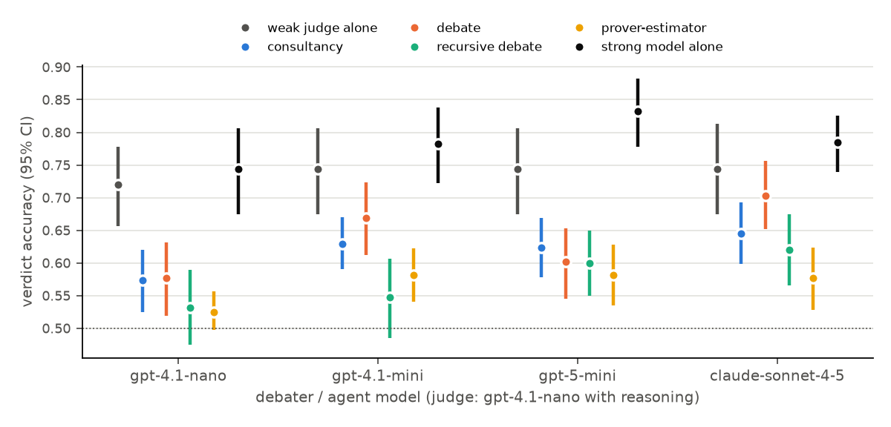
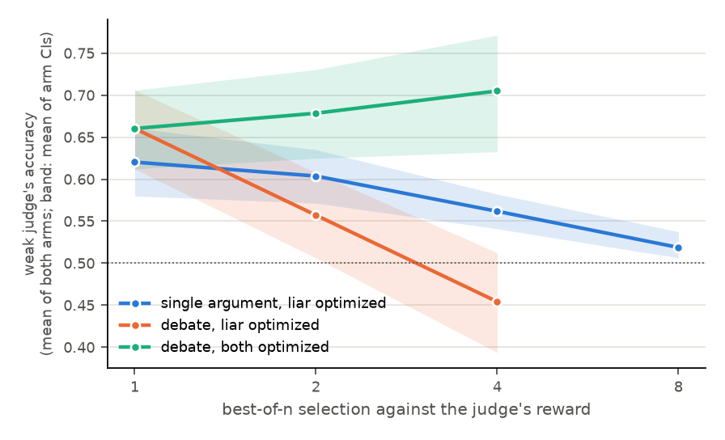

# Oversight protocols on the conceptual-reasoning testbed: first results

Does arguing help a weak judge reach the truth on questions that need conceptual reasoning? And does it keep
helping when the arguers are optimized against the judge? Questions come from the testbed
([testbed.md](testbed.md)): 10 families, 16 items each, with hidden ground truth from computation or
experiment.

**Setup.**
- Judge: gpt-4.1-nano, reasoning before it answers.
- Agents and debaters: gpt-4.1-nano, gpt-4.1-mini, gpt-5-mini (low reasoning effort) and Claude Sonnet 4.5.
- Instructed arms: on every item the agent argues the true answer in one episode and a false one in another.
- Protocols:
  - the judge alone;
  - consultancy (2 rounds);
  - debate (2 rounds, simultaneous);
  - recursive debate (depth 2, width 3);
  - prover-estimator debate (depth 2, width 3, $\rho=2$; Brown-Cohen et al. 2025);
  - as a reference, the agent model answering alone.
- Code: [`experiments/oversight_testbed.py`](../experiments/oversight_testbed.py) and
  [`oversight_report.py`](../experiments/oversight_report.py).
- Full tables: [`results/oversight_summary.md`](results/oversight_summary.md).
- Cost: about \$87 for the protocol comparisons (\$83 of it the gpt-5-mini and Sonnet arms), plus \$5 for the
  optimization runs.

## Findings

**1. On average, no protocol beat the weak judge reasoning alone, and debate came closest.** The judge alone
is right 72–74% of the time. Debate's accuracy rises with debater strength:

| debater model | debate | consultancy | recursive debate | prover-estimator | weak judge alone | debater model alone |
|---|---|---|---|---|---|---|
| gpt-4.1-nano | 0.58 | 0.57 | 0.53 | 0.53 | 0.72 | 0.74 |
| gpt-4.1-mini | 0.67 | 0.63 | 0.55 | 0.58 | 0.74 | 0.78 |
| gpt-5-mini (low effort) | 0.60 | 0.62 | 0.60 | 0.58 | 0.74 | 0.83 |
| Claude Sonnet 4.5 | **0.70** | 0.65 | 0.62 | 0.58 | 0.74 | 0.78 |

Each cell is over 160 items × 2 arms. 95% CIs are about ±0.05 (figure).

Reasoning effort matters as well as model. An earlier gpt-5-mini run at the default (medium) effort reached
0.74 for debate (CI 0.69–0.79), level with the judge alone. That run's 1,500-token cap broke the JSON-based
protocols, so it was discarded from the main comparison. Its debate and consultancy numbers stand.

**2. A protocol helps exactly where the arguers know more than the judge.** Across the 40 (family, debater)
cells, a protocol's gain over the judge alone correlates with the knowledge gap: the debater model's own
accuracy minus the judge's.

| protocol | Pearson $r$ with the knowledge gap ($p$) | mean gain where the gap is > 15 points (8 cells) | elsewhere |
|---|---|---|---|
| debate | 0.52 (0.001) | **+0.05** | −0.14 |
| consultancy | 0.71 (<0.001) | +0.02 | −0.16 |
| recursive debate | 0.54 (<0.001) | −0.02 | −0.20 |
| prover-estimator | 0.53 (<0.001) | −0.04 | −0.21 |

With Sonnet as debater, debate lifts the weak judge from 0.62 to 0.97 on Newcomb problems and from 0.75 to
0.98 on smoking-lesion problems; Sonnet alone gets both right. Where the debaters themselves are near chance,
debate becomes a contest of persuasion and costs the judge 10–30 points. Families: number-theory counts and
Collatz escape rates, RL reward hacking, LLM auctions.

This is the sandwiching condition stated as a measurement: argument transfers knowledge the arguers have. It
does not create knowledge. For conceptual domains, the practical question becomes whether models know more
than their overseers *there*. The testbed's knowledge-gap axis measures exactly that.

**3. Under optimization pressure, a single argument fails and symmetric debate holds.** Best-of-$n$ selection
was run against the weak judge's reward, computed exactly over sampled pools
([`experiments/optimization_testbed.py`](../experiments/optimization_testbed.py)): 120 items, gpt-4.1-mini
arguers, gpt-4.1-nano judge, \$2.8.

| the weak judge's accuracy | $n=1$ | $n=2$ | $n=4$ | $n=8$ |
|---|---|---|---|---|
| single argument, false side: judge fooled into the wrong answer | 0.59 | 0.75 | 0.87 | **0.96** |
| debate, only the liar optimized (mean of arms) | 0.66 | 0.56 | 0.45 | |
| debate, both debaters optimized (mean of arms) | 0.66 | 0.68 | **0.71** | |

This is a Goodhart curve in the plain sense. Optimizing a single argument for the judge's approval yields
arguments that fool it 96% of the time when the argued answer is false. Debate is robust *only if the honest
side is optimized too*. Optimizing the liar alone is as damaging as in the single-argument case. Optimizing
both sides improves accuracy. Self-play training is the regime the debate argument relies on, and here it
holds.

**4. Prover-estimator debate needs a coherent estimator, which prompted LLMs are not.** In the first run the
LLM estimator was accurate on the top-level claim. It priced a false claim at 0.43 on average and a true one at
0.83. But it then priced each subclaim in isolation, putting 0.99 on the bridge "these subclaims imply the
claim" and making $P(\text{all subclaims})>P(\text{claim})$. That incoherence is exactly what the protocol pays
the prover to find, so lying provers profited: concordance 0.36, meaning the reward favoured the false side.

Two changes followed:
- Stating the coherence constraint to the estimator ($P(\text{all})\le P(\text{claim})$).
- Requiring subclaims to be propositions.

After them, concordance rose to 0.55–0.66. ASD is about 0: payoffs are small differences of probabilities,
and the protocol's verdict (the sign of the prover's reward) is right only 52–58% of the time.

The guarantee of prover-estimator debate assumes an estimator at least as capable as the prover *and
calibrated and coherent across levels*. That is a property of a trained estimator, not of a prompted one.
The next experiment is to train or best-of-$n$ the estimator on the protocol's own reward and see whether
coherence, and with it soundness, emerges.

**5. Some families defeat everyone.** On the LLM-auction experiments every method is wrong more often than
not, the strong models included (Sonnet alone: 0.50). Models' intuitions about how LLM agents bid are
miscalibrated. Debate cannot fix that; evidence can. The essays experiment in `lvpm` finds that an essay
written from 16 resolved auction experiments lifts a reader from 19% to 71%.

## Caveats

- There are 16 items per family and one judge model. Per-family numbers are noisy (±0.2).
- Instructed arms are a weak adversary. The optimization experiment is the stronger test.
- The testbed's questions are crisper than real conceptual questions. These results are necessary
  conditions for the protocols, not evidence that they work on philosophy.
- The agents families' ground truth is a measured experiment with a minimum effect size, not a proof.

## Next

- A larger judge × debater grid, including a judge strong enough to follow the debaters but weaker than them.
- RL rather than best-of-$n$ for the optimization curves (so-arena's `integrations.rl`).
- Market making and peer prediction on the same items.
- LMCA items (tier B), once the data is available, to test the same protocols against expert ratings.
