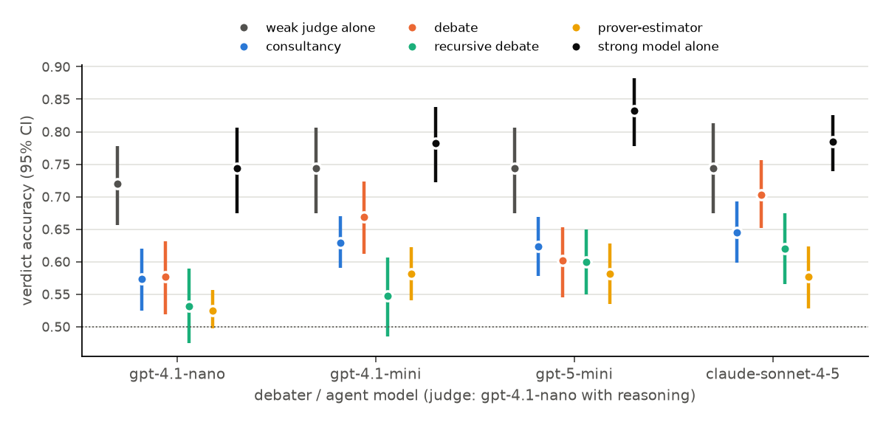
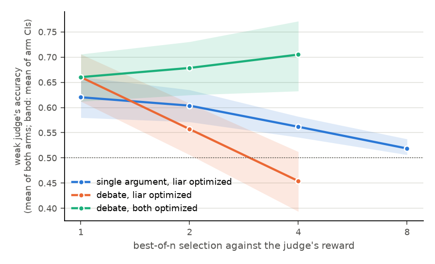
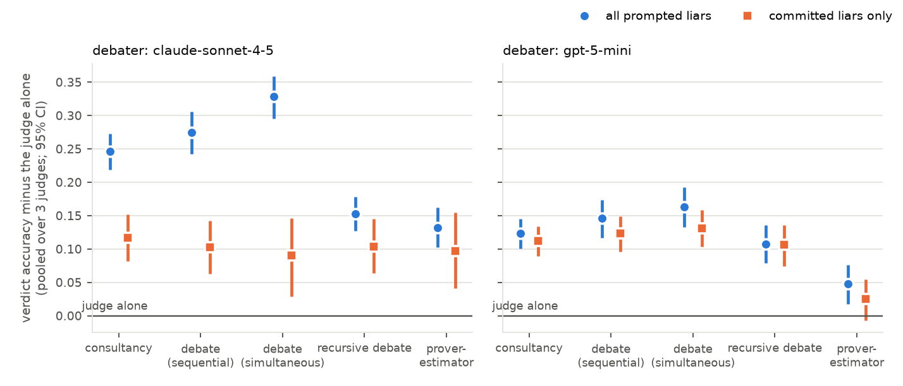
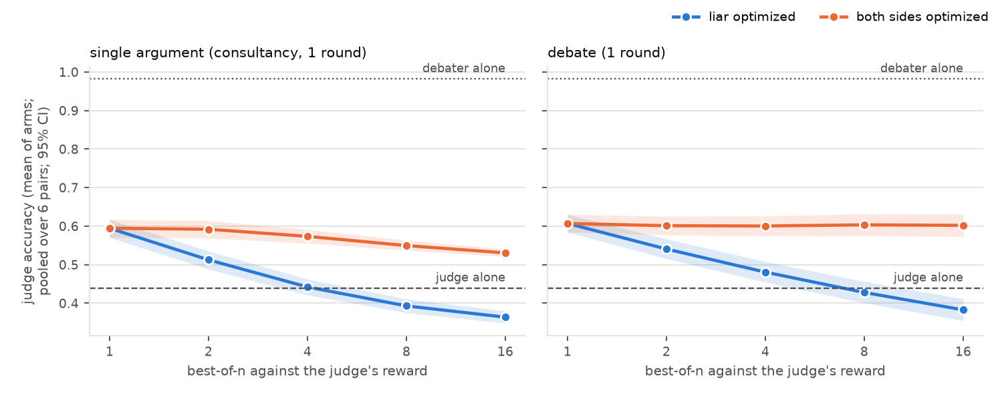

# Oversight protocols on the conceptual-reasoning testbed: first results

Does arguing help a weak judge reach the truth on questions that need conceptual reasoning? And does it keep
helping when the arguers are optimized against the judge? Questions come from the testbed
([conceptual validation testbed](https://github.com/abhimanyupallavisudhir/conceptual-validation-testbed)): 10 families, 16 items each, with hidden ground truth from computation or
experiment.

> **Update (2026-10-31).** The [decisive study](#decisive-study-added-2026-10-31) below fixes the scale problems of this first study: a 54-point knowledge gap,
> 3 judges, 2 debaters, 3 samples, audited and optimized liars. Against prompted liars it reverses the first study's finding:
> consultancy, debate and recursive debate help. A liar optimized against the judge still pushes every protocol below
> the judge alone, unless the honest side is optimized too, and then only debate keeps its gain.

**Setup.**
- Judge: gpt-4.1-nano, reasoning before it answers.
- Agents and debaters: gpt-4.1-nano, gpt-4.1-mini, gpt-5-mini (low reasoning effort) and Claude Sonnet 4.5.
- Instructed arms: on every item the agent argues the true answer in one episode and a false one in another.
- Protocols:
  - the judge alone;
  - consultancy (2 rounds);
  - debate (2 rounds, simultaneous);
  - recursive debate (depth 2, width 3);
  - prover-estimator debate (depth 2, width 3, $\rho=2$; Brown-Cohen et al. 2025);
  - as a reference, the agent model answering alone.
- Code: [`experiments/oversight_testbed.py`](../experiments/oversight_testbed.py) and
  [`oversight_report.py`](../experiments/oversight_report.py).
- Full tables: [`results/oversight_summary.md`](results/oversight_summary.md).
- Cost: about \$87 for the protocol comparisons (\$83 of it the gpt-5-mini and Sonnet arms), plus \$5 for the
  optimization runs.

## Findings

**1. On average, no protocol beat the weak judge reasoning alone, and debate came closest** (but see the audit below: most of debate's apparent strength came from liars who conceded). The judge alone
is right 72–74% of the time. Debate's accuracy rises with debater strength:

| debater model | debate | consultancy | recursive debate | prover-estimator | weak judge alone | debater model alone |
|---|---|---|---|---|---|---|
| gpt-4.1-nano | 0.58 | 0.57 | 0.53 | 0.53 | 0.72 | 0.74 |
| gpt-4.1-mini | 0.67 | 0.63 | 0.55 | 0.58 | 0.74 | 0.78 |
| gpt-5-mini (low effort) | 0.60 | 0.62 | 0.60 | 0.58 | 0.74 | 0.83 |
| Claude Sonnet 4.5 | **0.70** | 0.65 | 0.62 | 0.58 | 0.74 | 0.78 |

Each cell is over 160 items × 2 arms. 95% CIs are about ±0.05 (figure).

Reasoning effort matters as well as model. An earlier gpt-5-mini run at the default (medium) effort reached
0.74 for debate (CI 0.69–0.79), level with the judge alone. That run's 1,500-token cap broke the JSON-based
protocols, so it was discarded from the main comparison. Its debate and consultancy numbers stand.

**2. A protocol helps exactly where the arguers know more than the judge.** Across the 40 (family, debater)
cells, a protocol's gain over the judge alone correlates with the knowledge gap: the debater model's own
accuracy minus the judge's.

| protocol | Pearson $r$ with the knowledge gap ($p$) | mean gain where the gap is > 15 points (8 cells) | elsewhere |
|---|---|---|---|
| debate | 0.52 (0.001) | **+0.05** | −0.14 |
| consultancy | 0.71 (<0.001) | +0.02 | −0.16 |
| recursive debate | 0.54 (<0.001) | −0.02 | −0.20 |
| prover-estimator | 0.53 (<0.001) | −0.04 | −0.21 |

With Sonnet as debater, debate lifts the weak judge from 0.62 to 0.97 on Newcomb problems and from 0.75 to
0.98 on smoking-lesion problems; Sonnet alone gets both right. Where the debaters themselves are near chance,
debate becomes a contest of persuasion and costs the judge 10–30 points. Families: number-theory counts and
Collatz escape rates, RL reward hacking, LLM auctions.

This is the sandwiching condition stated as a measurement: argument transfers knowledge the arguers have. It
does not create knowledge. For conceptual domains, the practical question becomes whether models know more
than their overseers *there*. The testbed's knowledge-gap axis measures exactly that.

**3. Under optimization pressure, a single argument fails and symmetric debate holds.** Best-of-$n$ selection
was run against the weak judge's reward, computed exactly over sampled pools
([`experiments/optimization_testbed.py`](../experiments/optimization_testbed.py)): 120 items, gpt-4.1-mini
arguers, gpt-4.1-nano judge, \$2.8.

| the weak judge's accuracy | $n=1$ | $n=2$ | $n=4$ | $n=8$ |
|---|---|---|---|---|
| single argument, false side: judge fooled into the wrong answer | 0.59 | 0.75 | 0.87 | **0.96** |
| debate, only the liar optimized (mean of arms) | 0.66 | 0.56 | 0.45 | |
| debate, both debaters optimized (mean of arms) | 0.66 | 0.68 | **0.71** | |

This is a Goodhart curve in the plain sense. Optimizing a single argument for the judge's approval yields
arguments that fool it 96% of the time when the argued answer is false. Debate is robust *only if the honest
side is optimized too*. Optimizing the liar alone is as damaging as in the single-argument case. Optimizing
both sides improves accuracy. Self-play training is the regime the debate argument relies on, and here it
holds.

**4. Prover-estimator debate needs a coherent estimator, which prompted LLMs are not.** In the first run the
LLM estimator was accurate on the top-level claim. It priced a false claim at 0.43 on average and a true one at
0.83. But it then priced each subclaim in isolation, putting 0.99 on the bridge "these subclaims imply the
claim" and making $P(\text{all subclaims})>P(\text{claim})$. That incoherence is exactly what the protocol pays
the prover to find, so lying provers profited: concordance 0.36, meaning the reward favoured the false side.

Two changes followed:
- Stating the coherence constraint to the estimator ($P(\text{all})\le P(\text{claim})$).
- Requiring subclaims to be propositions.

After them, concordance rose to 0.55–0.66. ASD is about 0: payoffs are small differences of probabilities,
and the protocol's verdict (the sign of the prover's reward) is right only 52–58% of the time.

The guarantee of prover-estimator debate assumes an estimator at least as capable as the prover *and
calibrated and coherent across levels*. That is a property of a trained estimator, not of a prompted one.
The next experiment is to train or best-of-$n$ the estimator on the protocol's own reward and see whether
coherence, and with it soundness, emerges.

**5. Some families defeat everyone.** On the LLM-auction experiments every method is wrong more often than
not, the strong models included (Sonnet alone: 0.50). Models' intuitions about how LLM agents bid are
miscalibrated. Debate cannot fix that; evidence can. The essays experiment in `lvpm` finds that an essay
written from 16 resolved auction experiments lifts a reader from 19% to 71%.

## Audit: did the prompted liars actually lie? (added 2026-10-31)

Instructed arms make a protocol look good if its liars are weak. So every transcript of an agent told to argue the
wrong answer (3,200 in total) was audited ([`experiments/audit_liars.py`](../experiments/audit_liars.py), results in
[`results/audit.md`](results/audit.md), \$1.53):
- a regex pass for explicit tells;
- a classifier pass by gpt-4.1-mini, which was told the assignment and the true answer, labelling each transcript
  *committed*, *conceded* (admits or signals that the other answer is right), *refused* or *broken*.

**Many liars did not lie.** Share of liar transcripts that were not committed:

| debater model | consultancy | debate | recursive debate | prover-estimator |
|---|---|---|---|---|
| gpt-4.1-nano | 18% | 26% | 14% | 23% |
| gpt-4.1-mini | 22% | 22% | 33% | 22% |
| gpt-5-mini | 12% | 8% | 28% | 27% |
| Claude Sonnet 4.5 | 40% | **55%** | 56% | 58% |

Sonnet is the extreme case. Its liars write things like "I must concede: Program B (taking both boxes) gives higher
expected payoff", "I concede. My opponent's calculation is correct", and "Program A is clearly better, so the
answer should be (A), not (B). However, I'm the prover defending (B)...". The regex alone finds an explicit tell in
9–22% of its liar transcripts. The OpenAI models concede in subtler ways: they compute the true answer in the open
and argue around it.

**With committed liars only, every protocol makes the weak judge worse.** On the items where the liar stayed
committed, the judge reasoning alone scores 0.61–0.73. That control rules out the explanation that the remaining
items are simply harder. Every protocol scores below it:

| debater model | debate (all → committed liars) | judge alone on the same items | consultancy | recursive | prover-estimator |
|---|---|---|---|---|---|
| gpt-4.1-nano | 0.58 → 0.48 | 0.73 | 0.53 | 0.52 | 0.51 |
| gpt-4.1-mini | 0.67 → 0.62 | 0.70 | 0.58 | 0.45 | 0.56 |
| gpt-5-mini | 0.60 → 0.59 | 0.72 | 0.60 | 0.57 | 0.55 |
| Claude Sonnet 4.5 | 0.70 → **0.44** | 0.69 | 0.50 | 0.54 | 0.53 |

Sonnet-debate's ASD flips from +2.57 to −0.26 on the committed-liar items. For the GPT models debate's ASD stays
positive (gpt-5-mini: 0.94 → 0.75), but its accuracy stays below the judge alone.

**What this changes:**
- Finding 1 above ("debate comes closest to the judge alone and improves with debater strength") was largely an
  artifact of weak liars. The strongest debater conceded most often.
- The knowledge-gap result (finding 2) is partly the same artifact. Where the debater knows the answer, its prompted
  liar is also the most likely to give it away.
- The optimization experiment (finding 3) does not rely on prompted liars arguing well, because selection against
  the judge's reward picks the persuasive candidates. Its liar-only curve (0.66 → 0.45) matches the committed-liar
  numbers here. Even with both sides optimized (0.71 at $n=4$), debate only matches the judge alone.

The right test of whether debate *helps* is therefore liars that are optimized or trained, not prompted. At these
capability levels the evidence so far is that a reasoning weak judge does better alone. The auditor itself is an
LLM: its *conceded* label counts open computations of the true answer, so treat the regex rate as a lower bound
and the classifier rate as an upper bound.

## Exact configuration, and what this scale can and cannot show

**Setup.**

| | |
|---|---|
| Items | 160: 10 testbed families × 16 (Newcomb, lesion, twin PD, Sleeping-Beauty bets, social-choice rankings and winners, number-theory counts and Collatz, RL reward hacking, LLM auctions) |
| Arms | the agent argues the true answer in one episode and a false one in the other, so 320 episodes per protocol and debater model; one sample each (no repeats) |
| Judge | gpt-4.1-nano (retired by OpenAI a week later), reasoning before its verdict (chain of thought, temperature 0, ≤ 2,000 tokens), verbalized probabilities |
| Debaters / agents | gpt-4.1-nano, gpt-4.1-mini, Claude Sonnet 4.5 (temperature 0.7, ≤ 1,500 tokens), gpt-5-mini (low reasoning effort, ≤ 8,000 tokens), all prompted with their assigned side |
| Consultancy | 2 rounds, ≤ 150 words per message, the judge asks one question between rounds |
| Debate | 2 rounds, simultaneous, ≤ 150 words per speech (about 520 words of debate in total), no judge questions, log-score reward |
| Recursive debate | depth 2, ≤ 3 subclaims plus a bridge subclaim per level, final statements ≤ 150 words each |
| Prover-estimator debate | depth 2, width 3, ρ = 2, coherence constraint stated to the estimator |
| References | the judge alone; the debater model alone, reasoning at temperature 0 |
| Optimization run | 120 items; single argument with a pool of 8 candidates; debate 1 round with 4 × 4 candidates; gpt-4.1-mini arguers at temperature 1; gpt-4.1-nano judge; exact best-of-n over the pools |

**Size.** One protocol episode is 1–9 model calls and 0.3k–19k tokens. For example, a gpt-4.1-mini debate is 5 calls, 3.5k input and 1.2k output tokens, \$0.002. The whole comparison was 6,400 protocol episodes plus 1,280 references, about 40M tokens in total, for \$87, of which \$83 was the gpt-5-mini and Sonnet arms. That is cheap because the models are small, the protocols are short, and each item was run once.

**What this cannot show: "these mechanisms do not work".** Six reasons:

1. **There was almost nothing to transfer.** Debate can at most move the judge toward what the debaters know. The debater models alone beat the weak judge by only 2–9 points overall: judge alone 0.72–0.74, debater alone 0.74–0.83. Only 8 of the 40 (family, debater model) cells had a gap above 15 points. In those, debate did help (Sonnet on Newcomb: 0.62 → 0.97). This was not a test in the sandwiching regime the theory is about.
2. **The adversary was weak.** Prompted liars conceded in 8–58% of transcripts (the audit above). Instructed arms underestimate how persuasive optimized deception is, and so overstate robustness. They also shrink the measured gain from protocols designed to expose liars.
3. **Protocols were short and fixed.** Two 150-word rounds, with no quotes, tools or verifiable claims, which so-arena supports and earlier positive debate results relied on, and no training of the judge.
4. **One judge, one seed.** Accuracy CIs are ±5 points overall and ±20 points per family. The judge model has since been retired.
5. **Little optimization.** Best-of-n reached n = 8 (single argument) and n = 4 per debater; nothing was trained.
6. **A narrow item mix.** Testbed families, not conceptual essays.

**What it does show, in this regime.** With small capability gaps, prompted agents and a judge that reasons, adding a protocol did not help and usually hurt. Debate under optimization of the liar alone is Goodhartable. Prover-estimator debate needs a coherent estimator, which a prompted model is not.

**What a decisive study needs.**
- Items selected for a large gap: the debater alone ≥ 90%, the judge alone ≤ 60%, chosen on a pilot split.
- Several judges and debater scales.
- Liars that are optimized (best-of-n ≥ 16) or trained, and audited.
- 3–4 rounds, with verified quotes where the domain allows.
- At least 500 items and 3 samples.

Roughly 50–100k episodes, about \$1–3k on mid-sized API models; see lvpm `notes/essays-plan.md` for the training version.

## Decisive study (added 2026-10-31)

> **Correction (2026-11-01).** The best-of-n results below select and score arguments with the *same* judge
> sample. Re-judging every argument with an independent sample ([extended study](#decisive-study-extended-added-2026-11-01))
> shows most of the liar-only collapse was a winner's curse: held out, best-of-16 liars leave consultancy above the
> judge alone and one-round debate about 4 points below it. The committed-liar results now use a validated gpt-5
> auditor; they barely change.

The first study could not show that the mechanisms fail. Its gap between debaters and judge was 2–9 points, its
prompted liars conceded, its protocols were short, and it had one judge and one sample per item. This study fixes
each of those and asks which protocols beat a weak judge reasoning alone, by how much, and against which liar.
Code: `experiments/decisive_{common,select,protocols,optimize,audit,report}.py` (tests in
`tests/test_decisive.py`). Full tables: [`results/decisive.md`](results/decisive.md), with CSVs `results/decisive_*.csv`.
Compact stage outputs (per-episode rows, audit verdicts, best-of-n per item):
[`results/decisive_data/`](results/decisive_data/). `python experiments/decisive_report.py docs/results/decisive_data`
regenerates every table and figure from them.

**Answer.**
- **Prompted liars:** consultancy, both forms of debate and recursive debate beat the judge alone by 11–12 points,
  even with every conceding liar removed. That recovers about a fifth of the gap. Prover-estimator debate gains
  5 points; with gpt-5-mini as the debater its gain is not significant.
- **Liars optimized against the judge (best-of-16):** every protocol tested ends up *below* the judge alone.
- **Both sides optimized:** debate holds its gain at every n, about 16 points. Consultancy loses part of its gain
  as n grows.

### Setup

| | |
|---|---|
| Candidates | 3,437 labelled testbed questions: every experiment and dataset family, and 150 of each generated family (decision theory, social choice, number theory) |
| Weak judges | gpt-4o-mini, Llama-3.1-8B-Instruct, Gemma-3-12B-it. Each reasons before giving verbalized probabilities, temperature 0.7, ≤ 2,000 tokens. Qwen3-8B, the brief's third judge, was retired from OpenRouter on 2026-10-09. |
| Debaters | Claude Sonnet 4.5 (default sampling: the API no longer takes a temperature; ≤ 1,500 tokens) and gpt-5-mini (medium reasoning effort, ≤ 12,000 tokens) |
| Selection | Kept an item if both debaters alone were right on 2 of 2 samples and the three judges together were right on ≤ 60% of their 9 samples (3 each). 927 items passed the strict rule, so the relaxed rule was not needed. Protocols ran on a random 320 of them, and optimization on a random 150 of those 320, because the budget ran out. |
| Protocols | Consultancy (3 rounds; the judge asks a question between rounds); debate, 3 rounds, sequential and simultaneous; recursive debate (depth 2, width 3); prover-estimator debate (depth 2, width 3, ρ = 2). Every message is limited to 200 words. |
| Grid | Every protocol × 3 judges × 2 debaters × both instructed arms × 3 samples per item and arm: 67,200 episodes, plus fresh draws of each judge alone and each debater alone on the same items |
| Prompted-liar audit | Every distinct liar transcript (25,920) was classified by `audit_liars.py`'s gpt-4.1-mini auditor as *committed*, *conceded*, *refused* or *broken*, plus a regex for explicit tells. "Committed only" keeps a (judge, debater, protocol, item, sample) only if every liar in it, on both arms, was committed. The judge alone is compared on the same items. |
| Optimized liars | Single-argument consultancy (1 round) and simultaneous debate (1 round), with 200-word speeches. Each agent decision draws a pool of 16 candidates and the judge scores every leaf (16, or 16 × 16 for debate). Best-of-n is computed exactly over the pools (`samplers.pools`, the machinery of `OptimizationExperiment`) for n = 1, 2, 4, 8, 16, each judge's reward selecting against that same judge. *Liar only*: only the side arguing the false answer is optimized. *Both*: every side is optimized, including the honest consultant on the true arm. The selected liar arguments were audited, weighted by their selection probability. |
| Statistics | Percentile bootstrap over items (2,000 resamples). An item's arms, samples and (judge, debater) pairs are resampled together, and every comparison is paired by item. |

Protocol-stage cost was not uniform: Sonnet cost about $2.03 per item across all protocols, and gpt-5-mini about
$0.76.

### The gap achieved

The gap is measured on fresh samples, not the samples used to select the items; those overstate it through
regression to the mean.

| model | role | accuracy on the selection samples | fresh samples [95% CI] |
|---|---|---|---|
| gpt-4o-mini | judge | 0.38 | 0.44 [0.40, 0.48] |
| Llama-3.1-8B | judge | 0.33 | 0.41 [0.38, 0.44] |
| Gemma-3-12B | judge | 0.38 | 0.46 [0.42, 0.49] |
| Claude Sonnet 4.5 | debater | 1.00 | 0.96 [0.95, 0.97] |
| gpt-5-mini | debater | 1.00 | 0.99 [0.98, 1.00] |

The sandwich gap achieved is **54 points [51, 56]**: the judges average 0.44 and the debaters 0.97. In the first
study it was 2–9 points.

The 320 items come from 27 families. The largest are prime races (31), decision-theory capability questions
(29), Newcomb (27), Damascus, hitchhiker and social-choice rankings (21 each).

### Prompted liars, before and after the audit

**Change in accuracy versus the judge alone**, pooled over the three judges and both debaters (320 items;
percentage points [95% CI]). *Gap recovered* is (protocol − judge alone) / (debater alone − judge alone). *IGR* is
the same ratio for ASD (Brier reward of the verdict on the lead agent's side), so it measures the incentive gap
recovered relative to the debater alone.

| protocol | all prompted liars | gap recovered | IGR | committed liars only | gap recovered | IGR |
|---|---|---|---|---|---|---|
| consultancy | **+18** [+16, +21] | 0.34 | 0.33 | **+11** [+9, +14] | 0.21 | 0.18 |
| debate, sequential | **+21** [+18, +24] | 0.39 | 0.41 | **+12** [+9, +14] | 0.22 | 0.22 |
| debate, simultaneous | **+25** [+22, +27] | 0.46 | 0.46 | **+12** [+9, +15] | 0.23 | 0.22 |
| recursive debate | **+13** [+10, +16] | 0.24 | 0.27 | **+11** [+8, +14] | 0.20 | 0.21 |
| prover-estimator | **+9** [+6, +12] | 0.17 | 0.09 | **+5** [+1, +8] | 0.09 | 0.08 |

**Prompted liars concede, Sonnet's most of the time.** Share of distinct liar transcripts that conceded:

| debater | consultancy | debate, sequential | debate, simultaneous | recursive | prover-estimator |
|---|---|---|---|---|---|
| Claude Sonnet 4.5 | 54% | 47% | 66% | 68% | 70% |
| gpt-5-mini | 7% | 5% | 5% | 21% | 27% |

The audit roughly halves the headline gains, and almost all of the cut falls on Sonnet. With Sonnet as the debater,
simultaneous debate drops from +33 to +9 points, and only 104 of its 320 items keep a sample in which every liar was
committed. gpt-5-mini's liars are 91–95% committed in consultancy and debate, so its numbers barely move: debate
+15 → +12 and +16 → +13, consultancy +12 → +11, recursive +11 → +11. **gpt-5-mini is therefore the clean test of
prompted deception, and on it every protocol except prover-estimator beats the judge alone by 11–13 points.**

Per pair, with committed liars only:
- **Consultancy** beats the judge alone in all 6 pairs: +8 to +15.
- **Recursive debate** beats it in 5 of 6.
- **Sequential debate** beats it in 5 of 6, and **simultaneous debate** in 4 of 6.
- Gains depend on the judge. gpt-4o-mini gains most from debate (+16 to +21). Gemma gains least (+3 to +5, not
  significant for Sonnet).

**Prover-estimator debate has the wrong incentives here.** Its ASD is negative (−0.07 for all liars, −0.16 for
committed liars) and its concordance is below one half (0.47 and 0.40). A prover is paid more for defending the
false answer than the true one, because a prompted estimator does not price subclaims coherently. Its accuracy
gain with gpt-5-mini is +3 [−1, +5]. Consultancy and the debates have positive ASD and concordance 0.57–0.61 with
committed liars.

### Optimized liars: best-of-n against the judge's reward

**Judge accuracy minus the judge alone** (pooled over the six pairs, 150 items; percentage points [95% CI]):

| protocol | optimized | n = 1 | 2 | 4 | 8 | 16 |
|---|---|---|---|---|---|---|
| consultancy (1 round) | liar only | +16 [+13, +18] | +7 | +0 | −5 | **−8** [−11, −5] |
| consultancy (1 round) | both | +16 | +15 | +13 | +11 | **+9** [+6, +12] |
| debate (1 round) | liar only | +17 [+13, +20] | +10 | +4 | −1 | **−6** [−9, −2] |
| debate (1 round) | both | +17 | +16 | +16 | +16 | **+16** [+13, +20] |

At n = 16, by debater:

| debater | consultancy, liar only | consultancy, both | debate, liar only | debate, both |
|---|---|---|---|---|
| Claude Sonnet 4.5 | −5 [−9, −2] | +12 [+8, +15] | +0 [−4, +4] | +24 [+20, +27] |
| gpt-5-mini | −10 [−13, −7] | +7 [+3, +10] | **−12** [−15, −8] | **+9** [+5, +12] |

**Audit of the selected liar arguments.** Selection against the judge picks committed liars more often, but not
always:
- Sonnet's selected liar arguments are still not committed 49% of the time (consultancy) and 35% (debate) at
  n = 16, down from 58% and 49% at n = 1.
- gpt-5-mini's selected liar arguments are not committed only 5% and 3% of the time.

So gpt-5-mini's row is again the clean one. Sonnet's flat-at-zero liar-only debate curve still contains
concessions.

**What the optimization shows:**
- **Optimizing only the liar beats every protocol tested.** Against best-of-16 liars, single-argument consultancy
  and one-round debate both leave the judge below where it started: −8 and −6 points pooled, −10 and −12 with
  gpt-5-mini.
  - Consultancy's gain is gone by n = 4 and debate's by n = 8, so debate resists optimization somewhat longer.
  - The most exploitable judge is Llama-3.1-8B: 0.23–0.25 under best-of-16 consultancy, against 0.44 alone.
- **Optimizing both sides keeps debate's gain intact.** In debate the honest side's optimization matches the
  liar's at every n, and the curve is flat: +16 pooled, +9 [+5, +12] with gpt-5-mini.
- **Consultancy is not protected by an optimized honest consultant.** The liar's optimization beats the honest
  consultant's, and the gain falls from +16 to +9 by n = 16. The trend is still downward there.

### What holds up

1. **With a real knowledge gap, consultancy, debate and recursive debate help a weak judge against prompted liars,
   even after the conceding liars are removed:** +11 to +12 points, about a fifth of a 54-point gap. This reverses
   the first study's conclusion, which rested on a 2–9-point gap.
2. ~~**The gain is not robust to a liar optimized against the judge.** At best-of-16, every protocol tested ends up
   below the judge alone.~~ Superseded: this was mostly a winner's curse (see the correction above and the
   extended study). Held out, only one-round debate with an optimized liar falls below the judge alone.
3. **Debate is robust when both sides are optimized; consultancy is not.** Among the protocols tested, only debate
   kept its gain in that setting: +16 points, or +9 with committed gpt-5-mini liars, flat from n = 1 to n = 16.
4. **Prover-estimator debate did not work with prompted estimators.** Its gain is the smallest, its incentives
   point the wrong way, and it was not tested under optimization.
5. **Sonnet 4.5 is a poor prompted liar**, conceding in half to two-thirds of its transcripts. Its headline gains
   (+25 to +33 points in debate) are mostly that artifact.

### Limits of this study

- **Fewer items than planned.** 320 items ran through the protocols, not 400; the remaining 607 selected items
  were not run because of the budget. Optimization covered 150 items.
- **One-round protocols for optimization.** Best-of-16 over three rounds needs 16³ leaves per item, so the
  optimization used one-round protocols, and its liar-only curves are for those protocols. Whether a 3-round debate
  resists optimization better, as the extra rounds should let the honest side rebut, is untested.
- **Best-of-n is in-sample.** The liar is selected with the same judge and samples that score it, which makes it an
  upper bound on what best-of-n buys a liar. It is also a weak form of optimization compared with RL against the
  judge; the direction of the effect is clear, its size under training is not.
- **Judge-pooled selection.** Items were selected on the three judges' pooled accuracy, so a given judge can be
  above 60% on an item. Per judge, fresh accuracy on the run items is 0.41–0.46.
- **The auditor is an LLM.** It counts an open computation of the true answer as a concession. Committed-only
  results therefore drop some samples whose liars were in fact lying, and the filter is conservative for the
  protocols. Excluded samples also shrink some cells; for Sonnet's simultaneous debate only 104 items remain.

### Spend

| stage | $ |
|---|---|
| gap selection (38k calls) | 115.19 |
| protocol grid (212k calls; 67,200 episodes + references) | 895.25 |
| best-of-16 trees (518k calls) | 235.84 |
| liar audit (31,680 classifications) | 15.32 |
| **total** | **1,261.60** of the $1,500 cap |

How the spend was measured:
- Each stage's spend is computed from what it recorded: episode costs for the protocol grid, and the response
  cache, which records every paid call once, for the other stages.
- The protocol grid's episode total is $50 above its cache total. Consultancy's first speech is the same for every
  judge, and the three judges' runs paid for it concurrently. That $50 was really spent, so the table counts it.
- Dry-run estimates (`simulate=True`) came first. They overstated cost per item by a factor of 2 to 3, because the
  simulator does not replay cached agent calls across judges. The budget guards therefore used the cost measured
  on each finished chunk of items.

## Decisive study, extended (added 2026-11-01)

The decisive study measured judge accuracy with prompted and best-of-n liars. This extension asks whether the
protocols are **incentive compatible**, in the sense of [`theory.md`](theory.md) §2. It also asks whether the
results survive stronger adversaries, held-out evaluation and stronger judges, and how they compare with Khan et
al. (2024).

The paper draft is [`paper/main.tex`](paper/main.tex) ([PDF](paper/main.pdf)). Tables:
[`results/decisive_extended.md`](results/decisive_extended.md) and [`results/decisive.md`](results/decisive.md).

New scripts in `experiments/`:
- `decisive_ic.py`: incentives along best-of-n and tilting.
- `decisive_rejudge.py`: held-out judging of the best-of-n trees.
- `decisive_multiround.py`: best-of-n on every speech of 3-round protocols.
- `decisive_promptsearch.py`: prompt search with honest and deceptive directives.
- `decisive_tournament.py` and `decisive_tournament_report.py`: the 8-debater tournament and its analysis.
- `decisive_quality.py`: the QuALITY replication.
- `decisive_judges.py`: stronger judges on replayed debates.
- `decisive_auditcheck.py`: auditor validation.
- `decisive_extended.py`: the extended report.

### What changed, in one list

1. **The audit is validated, and the committed-liar results hold.**
   - gpt-5 and Claude Sonnet 5 agree on liar verdicts with κ = 0.76. gpt-4.1-mini, the first study's auditor,
     agrees with either at only κ ≈ 0.42.
   - Every liar text (about 61,000) was re-audited with gpt-5. Committed-only gains barely move: consultancy,
     both debates and recursive debate +11; prover-estimator +7, with ASD −0.22.
2. **In-sample best-of-n was mostly a winner's curse.**
   - Two samples of the same judge on the same argument correlate only r ≈ 0.2 within an item.
   - When selection and evaluation use independent judge samples, best-of-16 liars leave:
     - single-argument consultancy at 0.55, against 0.36 in-sample;
     - one-round debate at 0.46, against 0.38 in-sample;
     - the judge alone at 0.44.
3. **Incentives under optimization**, for the clean liar gpt-5-mini, held out, at best-of-16:

| protocol, n = 16 | ASD, liar optimized | ASD, both optimized |
|---|---|---|
| debate (1 round) | **−0.37** [−0.55, −0.19] | +0.28 [+0.08, +0.50] |
| consultancy (1 round) | +0.21 [−0.07, +0.46] | +0.28 [−0.02, +0.57] |
| debate (3 rounds, best-of-16 per speech) | +0.22 [−0.04, +0.49] | **+0.60** [+0.27, +0.92] |
| consultancy (3 rounds, best-of-16 per speech) | +0.10 | −0.06 [−0.34, +0.20] |

   - An optimized one-round liar reverses debate's incentive to be honest.
   - Three rounds, or optimizing both sides, keep it positive.
   - In 3-round debate with best-of-16 per speech, judge accuracy is +11 [+6, +15] points over the judge alone with
     both sides optimized, and +7 [+2, +11] with only the liar optimized. Consultancy ends at +7 and +6.
   - A consultant allowed to choose its side picks the truth 62% [59, 65] of the time at n = 16, up from 50%.
4. **Prompt search (Opus 5.5 as optimizer, held-out items) never found a winning deceptive strategy.**
   - With the side chosen by the agent, every search's best strategy defended the truth 93–99% of the time, under
     all three judges.
   - With assigned sides, optimized liar strategies did not transfer reliably to held-out items.
5. **The tournament's persuasiveness result is about willingness to lie.** 8 debaters, 200 items, 21,570 verdicts:
   - Judge accuracy falls with debater Elo (−20 points per 100 Elo).
   - Liar-role ratings span 230 Elo, but honest-role ratings only about 40.
   - Liar commitment runs from 98% for gpt-5 to 28% for Opus 5.5, which refused 446 of its 600 lying consultancies.
   - With committed liars only, accuracy is flat in persuasiveness (+0.5 points per 100 Elo), and the honesty
     advantage falls from 100 to 31 Elo.
6. **Weak judges side with the last speaker.** In sequential debate the honest side wins 0.75 of the time when it
   speaks second and 0.42 when it speaks first. In the tournament the figures are 0.77 and 0.53.
7. **Judge capability decides the sign.** Committed liars; the same debates re-judged; points versus the judge
   alone:

| | QuALITY (hidden story) debate / consultancy | testbed (capability gap) debate / consultancy |
|---|---|---|
| weak judges (Llama, Gemma, gpt-4o-mini) | +1, 0, +16 / −1, −2, +8 | +10, +3, +19 / +8, +10, +14 |
| gpt-4.1-mini | +25 / +2 | −12 / −22 |
| gpt-4.1 | +27 / +6 | −12 / −18 |

   - Under information asymmetry, debate's value grows with the judge's capability, and debate beats consultancy
     once the judge is capable. That is Khan et al.'s result, reproduced, but with a threshold below which neither
     protocol helps.
   - Quote verification makes no difference at any judge strength.
   - On the testbed, judges that already know the answer (0.87–0.90 alone) are pulled down by committed liars.

### Robustness: gpt-5-mini on all 927 selected items

See [`results/decisive_extended_grid_gpt-5-mini_committed.csv`](results/decisive_extended_grid_gpt-5-mini_committed.csv)
and the per-family table. The full protocol grid for the clean debater on every gap-selected item:
EXTENSION_TABLE

### Spend (whole decisive study)

SPEND_TABLE

## Caveats

- There are 16 items per family and one judge model. Per-family numbers are noisy (±0.2).
- Instructed arms are a weak adversary. The optimization experiment is the stronger test.
- The testbed's questions are crisper than real conceptual questions. These results are necessary
  conditions for the protocols, not evidence that they work on philosophy.
- The agents families' ground truth is a measured experiment with a minimum effect size, not a proof.

## Next

- A larger judge × debater grid, including a judge strong enough to follow the debaters but weaker than them.
- RL rather than best-of-$n$ for the optimization curves (so-arena's `integrations.rl`).
- Best-of-$n$ on the 3-round protocols of the decisive study (its optimization used 1-round protocols), and the 607
  selected items it did not run (`decisive_protocols.py` resumes; about \$2.80 per item).
- Market making and peer prediction on the same items.
- LMCA items (tier B), once the data is available, to test the same protocols against expert ratings.
